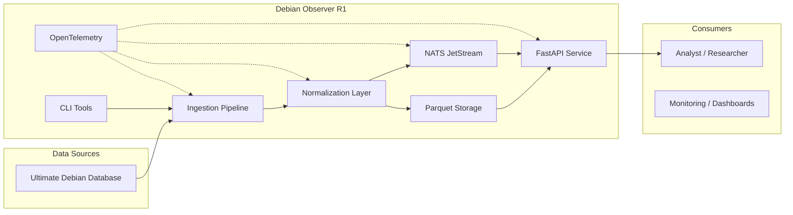

# Architecture Overview

High-level system architecture for Debian Observer R1.

## Component Diagram

**Data flow:** ingestion → normalization → storage (Parquet) + messaging (NATS) → API

**Telemetry:** OpenTelemetry traces and metrics throughout all components.

## Architecture Decision Records

See `docs/architecture/adr/` for detailed ADRs.
