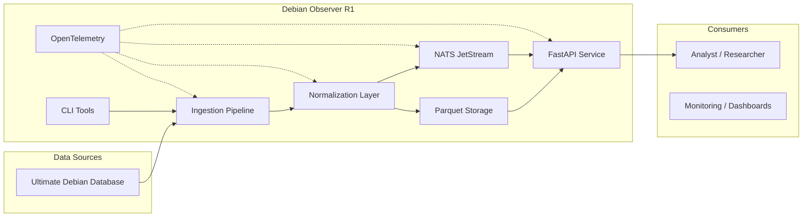
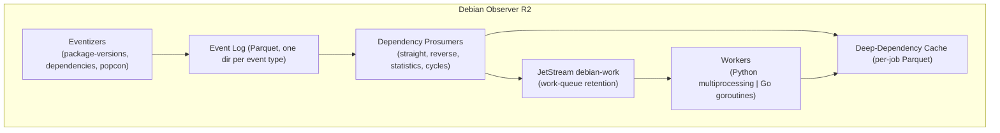

# Architecture Overview

High-level system architecture for Debian Observer R1.

## Component Diagram

**Data flow:** ingestion → normalization → storage (Parquet) + messaging (NATS) → API

**Telemetry:** OpenTelemetry traces and metrics throughout all components.

## Architecture Decision Records

See `docs/architecture/adr/` for detailed ADRs.

## Release 2 additions (Dependency & Release Dynamics)

R2 turns R1's package observations into a dependency network
(spec: `docs/release2.project.v0.2.md`). New components:

 - **Eventizers** (ADR-014): per-source eventization selected by
   `normalize udddump --eventizer NAME`
 - **Event log layout** (ADR-015): one directory per event type,
   one file per run; prosumers read the lake in batches
 - **Derived tables** (ADR-016): flat layout
 - **Work distribution** (ADR-018): `debian-work` work-queue
   stream, durable pull consumer, explicit ack after atomic
   output write. Idempotency by deterministic keys and paths
   (ADR-019).
 - **Workers**: Python `multiprocessing` baseline (sharing the
   graph via `fork()` copy-on-write) vs a Go arm — decided by
   measurement in ADR-017 (E4)
