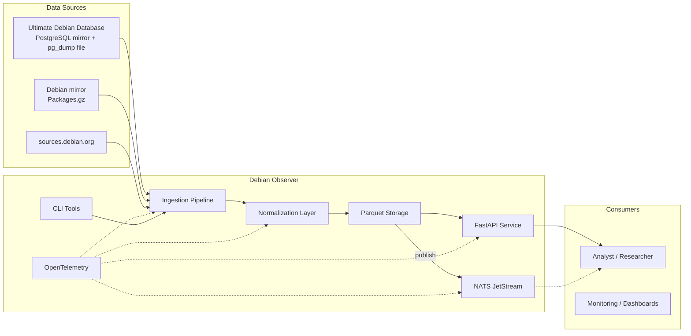

# Architecture Overview

High-level system architecture for the Debian Observer platform.

## Component Diagram

**Data flow:** ingestion → normalization → the Parquet event log (the
backbone); `consolidate` folds the log into the consolidated table;
publishing to NATS JetStream is the explicit `publish` command (a
rebuildable view); the API serves the consolidated table.

**Telemetry:** OpenTelemetry traces and metrics throughout all components.

## Architecture Decision Records

See `docs/architecture/adr/` for detailed ADRs.

## Release 2 additions (Dependency & Release Dynamics)

R2 turns R1's package observations into a dependency network
(spec: `docs/release2.project.v0.4.md`). Platform additions:

- **Eventizers** (ADR-014): per-source eventization selected by
  `normalize udddump --eventizer NAME` — `package-versions`
  (`PackageVersionObserved`), `dependencies`
  (`DependencyObserved`), `popcon` (`PopconObserved`).
- **Event log layout** (ADR-015): one directory per event type,
  one file per run; prosumers read the lake in batches.
- **Prosumer libraries**: `prosumers/` (`stream`, `cli`,
  `packages`, `coordinates`, `lake`) plus the example prosumers in
  `src/prosumers/` (installed as `debian-observer-consolidate` /
  `debian-observer-filter`).

Deep-dependency analysis — the derived tables (ADR-016), work
distribution over the JetStream `debian-work` queue (ADR-018),
idempotency by deterministic keys and paths (ADR-019) and the
Python/Go workers (ADR-017) — is implemented by the **dopi-pdda**
plug-in on top of the platform; it is not part of this repository,
and the platform never imports plug-ins (ADR-022 in the R2 spec:
the arrow points from plug-in to platform).
